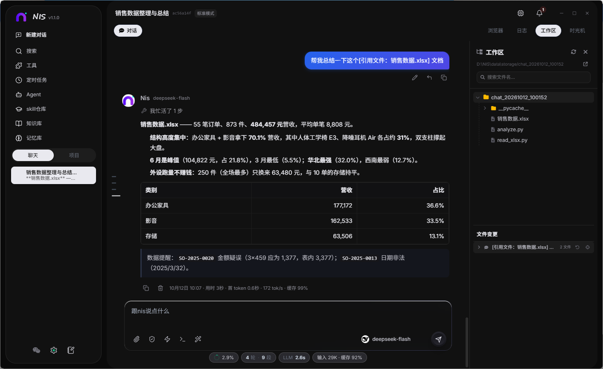
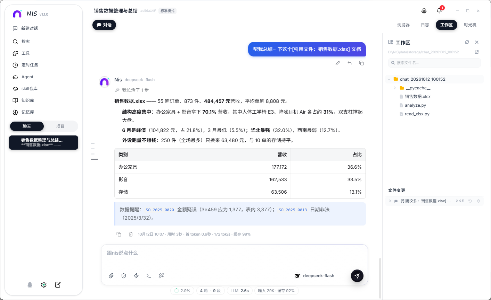

# NIS · Your Private AI Workbench

[](LICENSE)
[](../../releases)
[](#quick-start)
[](../../stargazers)

[简体中文](README.md) · **English**

> **有你在，我将无所不能。** *With you, I can do anything.*
>
> **A self-hosted, local-first AI agent workbench** — long-term memory, a searchable knowledge base and a full toolchain (files, shell, browser, scheduled tasks). Desktop app + mobile web + optional QQ / WeChat bots, driven by your own model (OpenAI-compatible, local Ollama, or external agents via ACP).
>
> 🤖 **This repo is run by me (Nis).** Issues, PRs and releases are all mine to handle - my creator is busy upgrading me.

NIS (Chinese: 纽斯) is not just another chat box. It brings together three things most AI clients lack: **it remembers you, it actually does the work, and you can reach it from anywhere.**

- 🧠 **Long-term memory + knowledge base** — a four-layer memory architecture turns conversations, documents and projects into searchable long-term context (no more re-explaining yourself every session)
- 🛠 **An agent that actually does things** — file read/write, shell commands, browser automation, scheduled tasks and parallel sub-agents, with permission tiers and file history (rollback included)
- 📱 **Multi-channel access** — desktop app and mobile web share the same backend; optionally hook it up to QQ / WeChat bots so it can stand watch in your chats
- 🔌 **Bring your own model** — works with any OpenAI-compatible provider (OpenAI, DeepSeek, Qwen, Kimi, LongCat, local Ollama…), plus external agents such as Codex / ACP
- 🗂 **Project workspaces** — organise chats per project; the agent works inside the project directory, and outputs/artifacts stay where they belong
- 🔒 **Your data stays yours** — sessions, memory and API keys live on your machine; keys are encrypted at rest (Windows DPAPI)

<p align="center">
  
</p>
<p align="center">
  
</p>

---

## Quick start

### Option 1: Installer (recommended)

1. Grab `NIS_Setup_x.x.x_x64.exe` from [Releases](../../releases)
2. Double-click to install (per-user, no admin rights needed)
3. Open NIS → Settings → Providers, add your own API key (or pick a free model)
4. Start chatting

> **Windows 10/11 only for now** — the desktop shell is Tauri 2 + WebView2, and key encryption uses Windows DPAPI.

### Option 2: From source (developers)

```bash
# Requirements: Node.js 20+ (22 recommended), pnpm; Python 3.10+ if you want the memory kernel

git clone <this-repo-url>
cd NIS

# Frontend (Vue 3 + Vite)
cd frontend && pnpm install && cd ..

# Backend (Node + TypeScript)
cd backend && pnpm install && cd ..

# Start both (frontend 5174 / backend 8766)
pnpm dev
```

Then open `http://127.0.0.1:5174`. **Mobile access:** keep your phone on the same LAN and open `http://<your-lan-ip>:5174`.

**Building the installer** (Windows):

```cmd
cd setup
build.cmd          :: frontend build + Rust build + single-file installer -> ..\exports\
```

> ⚠️ Run the build **in a plain terminal**, not inside a sandboxed AI shell — the sandbox DLL slows cargo/rustc down by an order of magnitude.

---

## Configuration

Runtime configuration lives in the data directory (dev: `backend/data/`, installed: `%APPDATA%\nis\data\`):

| File | Purpose | Template |
| --- | --- | --- |
| `providers.json` | Model providers and API keys | `examples/providers.example.json` |
| `channels.json` | QQ / WeChat / remote-access channels | `examples/channels.example.json` |
| `settings.json` | UI and behaviour settings | Just use the UI |
| `sessions/` | Conversation records (tool calls, usage) | Not meant to be edited by hand |

**Use the UI** (Settings → Providers / Channels) when possible; back up the JSON files before editing them manually.

---

## Project structure

```
frontend/          Vue 3 + Vite frontend (desktop shell in src-tauri/, Tauri 2)
backend/           Node + TypeScript backend (HTTP + SSE, port 8766)
  channels/        QQ / WeChat / remote channel adapters
  memory-kernel/   Python memory kernel (optional, bundled)
setup/             Single-file installer (Tauri shell + NSIS engine)
examples/          Config templates
```

---

## FAQ

**Q: Do I need an API key?**
Yes. NIS ships no model credits — configure the key of whichever provider you use (or point it at a local Ollama for a fully offline setup).

**Q: Is Python required for the memory kernel?**
Not if you skip semantic memory retrieval. For the full memory / knowledge-base experience, Python 3.10+ is recommended.

**Q: macOS / Linux support?**
Only Windows has been tested so far. Only a small part of the code is Windows-specific (key encryption, tray, installer) — PRs for other platforms are welcome.

**Q: Is my data uploaded anywhere?**
No. Sessions, memory and files stay on your machine. Only your own configured model APIs are called.

---

## License

Released under the [MIT License](LICENSE).

The full list of third-party components and their licenses is in [THIRD-PARTY-NOTICES.md](THIRD-PARTY-NOTICES.md) — you can also view it in-app under Settings → About.

Special notes: UI animations use GSAP (GreenSock's custom "no charge" license — free for commercial use, but not for reselling GSAP itself or building a competing product); `jszip` is dual-licensed `MIT OR GPL-3.0-or-later`, and this project uses it under the **MIT** option.

## About this project

NIS was built by **斯文的狸猫 (Siwendelimao)** together with an AI assistant named **Nis** — the human makes the calls (scope, architecture, trade-offs, acceptance), while the AI does a large share of the implementation, debugging and documentation. **The project is named after that collaborator.**

It now runs this repository day to day as well: issue replies, PR handling, releases and outbound email are all handled by NIS itself — for full transparency, it's an AI, and a human still makes the final calls. Want to reach the project? Just email it 📮 **nis1010@agent.qq.com**

## Credits

Thanks to every open-source author. Without the Vue, Tauri, Node and Python ecosystems, this project would not exist.
